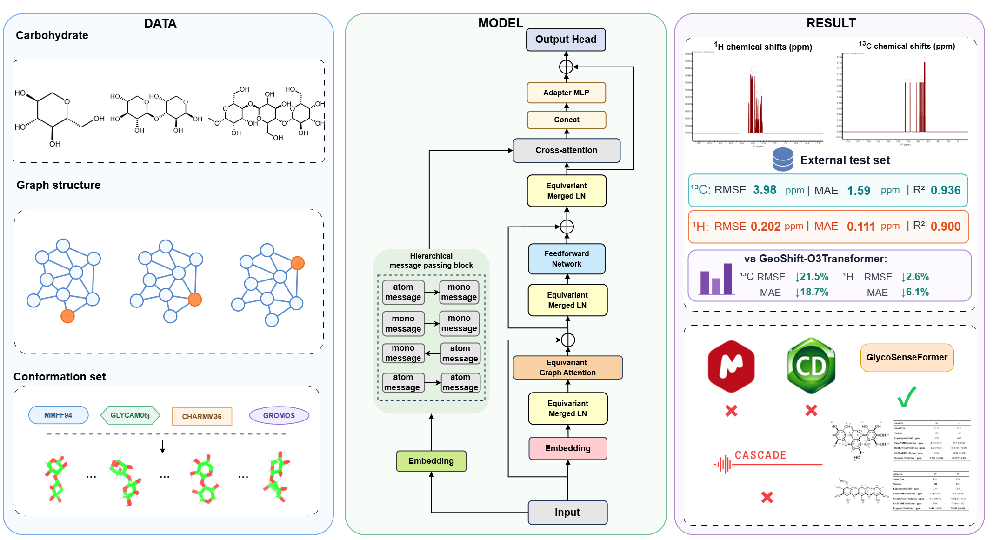

# GlycoSenseFormer

**A Hierarchical SE(3)-Equivariant Model for Carbohydrate NMR Chemical Shift Prediction**



GlycoSenseFormer predicts carbohydrate $^{13}\mathrm{C}$ and $^{1}\mathrm{H}$ NMR chemical shifts. It uses cross-attention to combine the three-dimensional geometry of multiple conformers with glycan context from a hierarchical atom–residue encoder.

## Setup

Clone the repository and create the Conda environment on Linux or WSL2.

```bash
git clone https://github.com/GlycoSenseFormer/GlycoSenseFormer.git
cd GlycoSenseFormer
conda env create -f environment.yml
conda activate glycosenseformer
```

## Run

Supply prepared input graphs and model checkpoints separately.

```bash
python scripts/train_legacy.py --help
python scripts/predict.py --help
```

[Molecular dynamics and conformer selection](md/README.md).
